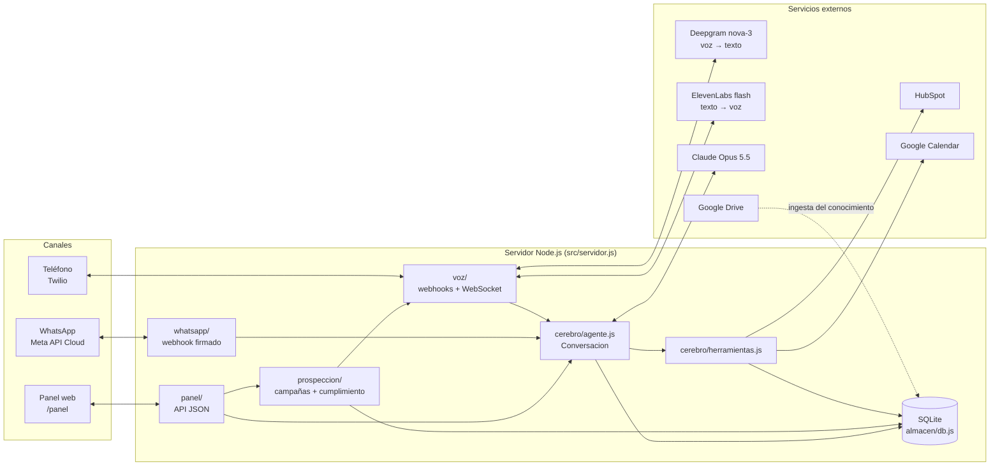
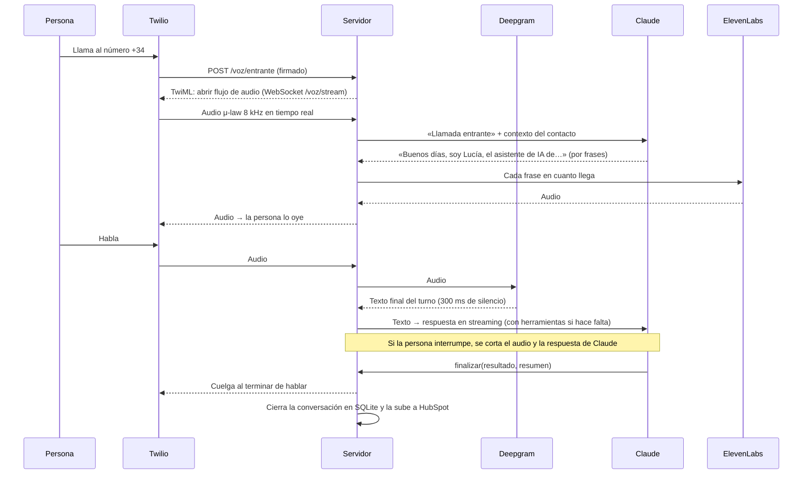
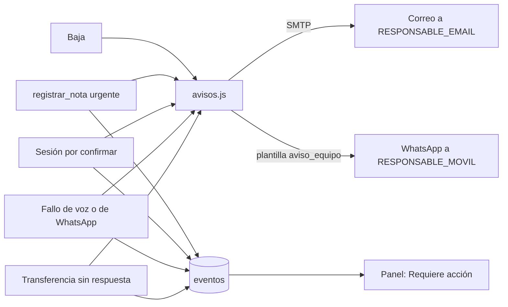

# Arquitectura del asistente de Familias Empresarias

Este documento explica cómo está montado el asistente: qué piezas tiene, cómo viaja una llamada o un WhatsApp, cuánto tarda en responder y cuánto cuesta aproximadamente cada minuto.

## 1. Visión general

Es un único servidor Node.js (versión 22, sin TypeScript) que hace de centralita y de comercial:

- **Canales**: llamadas de teléfono entrantes y salientes (Twilio) y WhatsApp (API Cloud de Meta).
- **Cerebro**: Claude Opus 5.5 (`claude-opus-5-5`), el mismo modelo en todos los canales. En voz trabaja con esfuerzo bajo para responder sin pausas; en WhatsApp, con esfuerzo medio.
- **Herramientas**: lo que el asistente puede hacer durante la conversación (buscar en el conocimiento, leer y actualizar la ficha del CRM, consultar huecos y agendar reuniones, enviar un WhatsApp, pasar la llamada a una persona, registrar una baja y cerrar la conversación con su resultado).
- **Integraciones**: HubSpot (CRM), Google Calendar (agenda), Google Drive (documentos del conocimiento), Deepgram (voz a texto), ElevenLabs (texto a voz), Atalaya 360° (sesiones en la mesa de trabajo e invitaciones de alta) y un servidor SMTP para los avisos al equipo.
- **Fuentes de verdad**: HubSpot para la relación comercial, Atalaya para los datos de la empresa cliente y la asistente (SQLite) para la operación y el cumplimiento (bajas, bases legales, plazos).
- **Datos**: una base SQLite local (`datos/asistente.db`) con conversaciones, mensajes, campañas, bajas, lista Robinson y métricas. HubSpot es la ficha comercial; SQLite es el registro operativo y de cumplimiento.
- **Avisos**: lo que no puede esperar (transferencia sin respuesta, urgencia, fallo técnico, sesión por confirmar, baja) llega en el momento a Valerio por correo y, con plantilla aprobada, por WhatsApp; y queda en la bandeja «Requiere acción» del panel.
- **Panel**: una web protegida en `/panel` para el día a día: resumen, bandeja «Requiere acción», conversaciones con búsqueda, filtros y CSV, ficha de cada contacto con su cronología, campañas, bajas y lista Robinson, estado de las integraciones, recarga del conocimiento y prueba del asistente por texto.
- **Conservación**: una purga diaria borra o anonimiza lo que supera los plazos de `CUMPLIMIENTO.md` §6.3.

### Módulos (carpeta `src/`)

| Carpeta | Qué hace |
|---|---|
| `config.js` | Lee toda la configuración de variables de entorno (o de un fichero `.env`). |
| `servidor.js` | Servidor HTTP y WebSocket. Cada módulo registra sus rutas al cargarse. `/salud` para comprobar que está vivo. |
| `almacen/db.js` | Base de datos SQLite: contactos, conversaciones, mensajes, bajas, lista Robinson, campañas, eventos. |
| `cerebro/` | La conversación con Claude (`agente.js`), las instrucciones (`prompt.js`) y las herramientas (`herramientas.js`). |
| `conocimiento/` | Paquete de conocimiento que va en las instrucciones (ficheros `.md` de `datos/conocimiento`) e ingesta desde Drive y la web (`npm run ingestar`). |
| `voz/` | Webhooks de Twilio, flujo de audio en tiempo real, Deepgram, ElevenLabs y `llamar()` para las salientes. |
| `whatsapp/` | Webhook de Meta, mensajes de texto y notas de voz, plantillas. |
| `crm/` | HubSpot: ficha, notas, tareas, reuniones, llamadas y bajas. `preparar-hubspot.js` crea las propiedades propias. |
| `agenda/` | Google Calendar: huecos libres y reservas. |
| `prospeccion/` | Campañas, importación de contactos, reglas de cumplimiento y planificador de llamadas. |
| `panel/` | Panel web y su API (`textos.js`: textos legibles de cada código). |
| `avisos.js`, `correo.js` | Avisos inmediatos al equipo (correo SMTP sin dependencias y WhatsApp con plantilla). |
| `integraciones/` | Atalaya 360° (`atalaya.js`, contrato común) y estado de todas las integraciones para el panel (`estado.js`). |
| `conservacion.js` | Purga diaria de mensajes, grabaciones, eventos y fichas al vencer los plazos. |

## 2. Flujos

### 2.1 Llamada entrante

1. Twilio recibe la llamada y avisa a `/voz/entrante`. El servidor comprueba la firma `X-Twilio-Signature`.
2. Se abre el flujo de audio. El servidor identifica al contacto por su número (SQLite y HubSpot) y prepara a Claude con su historial.
3. El asistente saluda y se presenta **siempre como inteligencia artificial**.
4. Cada turno: Deepgram transcribe, Claude responde por frases, ElevenLabs las convierte en voz y Twilio las reproduce.
5. Si la persona lo pide o hay una urgencia, `transferir_llamada` la pasa al móvil del responsable con un `<Dial timeout="25" action="/voz/transferencia-fin">`. Si nadie contesta (`DialCallStatus` no-answer, busy o failed), Twilio vuelve a `/voz/transferencia-fin`: se le dice que le devolverán la llamada, se crea una tarea de prioridad alta en HubSpot, se avisa al equipo y la conversación queda con «Transferencia: sin respuesta». Si contesta, queda «atendida».
   Si Claude falla a mitad de llamada, la disculpa queda en la transcripción, se avisa al equipo y la tarea de volver a llamar es de prioridad alta.
6. Al despedirse, Claude usa `finalizar`; la llamada se cuelga y el resumen, el resultado y la transcripción quedan en SQLite y en HubSpot. Si pidió que le llamaran en otro momento, `finalizar` lleva la fecha y hora (`volver_a_llamar`): la tarea de HubSpot vence entonces y, en campaña, la siguiente llamada se hace a esa hora.
7. Con `GRABAR_LLAMADAS`, Twilio avisa en `/voz/grabacion` al terminar la grabación; el panel la sirve desde Twilio (con las credenciales de la cuenta) en la conversación.

### 2.1 bis Sesión estratégica

La primera reunión es siempre la **sesión estratégica**: 60 minutos (`REUNION_MINUTOS`), con Valerio García, sin coste. El mismo nombre en las instrucciones, el evento de Google Calendar («Sesión estratégica · empresa»), la reunión de HubSpot y el negocio («empresa · sesión estratégica»). Al reservarla, `agendar_reunion` avisa a Atalaya (`POST {ATALAYA_URL}/api/integracion/reunion`, cabecera `Authorization: Bearer INTEGRACION_TOKEN`, cuerpo `{ id, inicio, fin, titulo, enlace, nombre, email, telefono, empresa, hubspotContactId, hubspotCompanyId, origen: 'asistente' }`) para que aparezca en la mesa de esa empresa. Sin agenda conectada, la petición queda «por confirmar»: no cuenta como agendada, avisa al equipo y aparece en la bandeja del panel hasta que alguien la resuelve.

### 2.2 Llamada saliente (prospección)

1. El planificador (`prospeccion/campanas.js`) se ejecuta cada minuto **solo si `PROSPECCION_ACTIVA=sí`**.
2. Toma los siguientes contactos de las campañas activas y pasa cada uno por `puedeLlamar()` (base legal, baja, lista Robinson, horario, festivos, intentos y separación entre intentos). Ver `CUMPLIMIENTO.md`.
3. Respeta el número máximo de llamadas a la vez (`PROSPECCION_SIMULTANEAS`).
4. Llama a `llamar()` de `voz/rutas.js`, que pide a Twilio la llamada con detección de contestador.
5. Cuando la persona contesta, el asistente se presenta como IA, dice por qué llama (relacionándolo con cómo se conocieron) y pregunta si es buen momento. Abre con el «dolor» de la campaña (por ejemplo, «incrementar ventas rentables»).
6. Si salta un contestador, cuelga sin dejar mensaje (resultado `buzon`).
7. Al acabar, el resultado (`reunion_agendada`, `no_interesado`, `buzon`, `volver_a_llamar`…) se guarda en la campaña. No contesta, comunica o buzón → se reintenta pasadas 48 horas, hasta el máximo de intentos. «Volver a llamar» con hora pedida → se llama a esa hora. La campaña de origen queda en HubSpot (`fe_campana` y el título de la llamada).
8. Al importar contactos, el panel avisa de los que no se llamarán nunca en esa campaña por su base legal.

### 2.2 bis Panel y avisos

La bandeja lee de `eventos` los tipos `reunion_pendiente`, `transferencia_sin_respuesta`, `urgencia`, `voz_error`, `whatsapp_error` y `whatsapp_fallo` sin resolver; «Marcar como resuelto» rellena `eventos.resuelto`. Las exportaciones CSV usan «;», BOM UTF-8 y neutralizan las celdas que empiezan por `=`, `+`, `-` o `@`.

### 2.3 WhatsApp

1. Meta envía cada mensaje a `/whatsapp/webhook`; el servidor comprueba la firma `X-Hub-Signature-256`.
2. Si es una nota de voz, se transcribe con Deepgram.
3. Claude responde con el contexto del contacto y su historial; puede usar las mismas herramientas (salvo transferir llamada).
4. Dentro de las 24 horas desde el último mensaje de la persona se responde libremente; fuera de esa ventana solo se puede escribir con plantillas aprobadas por Meta.
5. Si la persona escribe «baja» o algo equivalente, queda registrada y no se le vuelve a escribir.

## 3. Latencia de voz

**Objetivo: menos de 1 segundo** desde que la persona deja de hablar hasta que oye la primera palabra.

| Tramo | Tiempo aproximado |
|---|---|
| Deepgram detecta el final del turno (300 ms de silencio) | 300 ms |
| Claude Opus 5.5 con esfuerzo bajo, hasta la primera frase completa | 400–700 ms (la parte mayor) |
| ElevenLabs flash, primer audio de la frase | 150–250 ms |
| Red Twilio ↔ servidor | 50–100 ms |
| **Total** | **0,9–1,3 s** |

Cómo se consigue:

- Claude responde en streaming y cada frase se manda a la voz en cuanto termina, sin esperar al resto.
- Las instrucciones y el conocimiento van en caché (una hora), así Claude no los vuelve a procesar en cada turno.
- Las conexiones con Deepgram y ElevenLabs se abren al empezar la llamada.
- Conviene alojar el servidor en Europa (Fráncfort, Dublín, París o Madrid), cerca de Twilio y de los proveedores.

Cada turno queda medido en la tabla `eventos` (tipo `latencia`, en milisegundos). El panel muestra la media del día.

## 4. Costes aproximados por minuto de llamada

> **Estimaciones a verificar con las tarifas vigentes** de cada proveedor antes de presupuestar. Precios en dólares (la mayoría factura en dólares), sin IVA.

| Concepto | Supuesto | Coste por minuto |
|---|---|---|
| Twilio, llamada entrante a número español | tarifa de entrada de número local | ≈ 0,01 $ |
| Twilio, llamada saliente a móvil español | varía mucho según destino; a fijo es menor | ≈ 0,03–0,10 $ |
| Twilio Media Streams (audio en tiempo real) | por minuto de flujo | ≈ 0,004 $ (a confirmar) |
| Twilio, detección de contestador (salientes) | por llamada | ≈ 0,0075 $ por llamada |
| Deepgram nova-3 en streaming | toda la duración de la llamada | ≈ 0,008 $ |
| ElevenLabs flash | el asistente habla ~40 % del minuto (~400 caracteres); depende del plan | ≈ 0,02–0,05 $ |
| Claude Opus 5.5 | ~4 turnos por minuto; ver detalle | ≈ 0,04–0,09 $ |
| **Total entrante** | | **≈ 0,08–0,16 $/min** |
| **Total saliente** | | **≈ 0,10–0,25 $/min** |

Detalle de Claude (tarifa indicada: 4 $ por millón de tokens de entrada, 20 $ por millón de salida, lectura de caché a 0,20 $ por millón):

- Cada turno relee las instrucciones y el conocimiento desde la caché. Con un paquete de conocimiento de unos 20.000–90.000 tokens (el máximo configurado es 60.000 palabras), son entre 0,004 $ y 0,018 $ por turno.
- Lo nuevo de cada turno (lo que dice la persona, resultados de herramientas) son unos cientos de tokens: ≈ 0,002 $.
- La respuesta hablada son unos 60–100 tokens: ≈ 0,002 $.
- Una vez por hora y canal se escribe la caché de las instrucciones (precio de escritura de caché más alto): del orden de 0,20–0,80 $ por hora de actividad.

Para bajar el coste de Claude: mantener el paquete de conocimiento corto (lo detallado se consulta con `buscar_conocimiento`) y ajustar `CONOCIMIENTO_MAX_PALABRAS`.

Costes fijos aproximados (a verificar): número español en Twilio (unos pocos dólares al mes), plan de ElevenLabs, servidor (5–25 € al mes), dominio. WhatsApp: Meta cobra por conversación o por plantilla según la categoría (marketing, utilidad, servicio); las respuestas dentro de la ventana de 24 horas iniciadas por el cliente suelen ser gratuitas o muy baratas. Consulte la tabla de precios vigente de Meta para España.

## 5. Seguridad

- Los webhooks comprueban la firma de Twilio y de Meta; las peticiones sin firma válida se rechazan.
- El panel exige usuario y contraseña, usa una cookie `HttpOnly`, `SameSite=Strict` y firmada, limita los intentos de acceso y escapa todo lo que viene de la base de datos.
- Lo que dicen los interlocutores y lo que devuelven las APIs se trata como datos, nunca como instrucciones.
- Las claves solo están en variables de entorno o en `.env` (fuera de git); no se escriben en los registros.
- La base de datos se guarda en `datos/` con permisos restringidos; haga copias de seguridad cifradas.
- La integración con Atalaya usa un token compartido (`INTEGRACION_TOKEN`) en la cabecera `Authorization`; sin él no se envía nada. El correo de avisos no manda la contraseña SMTP sin cifrar (TLS directo o STARTTLS).
- Las bajas del panel llegan también a HubSpot, y una baja por correo bloquea el teléfono del mismo contacto (y al revés).
